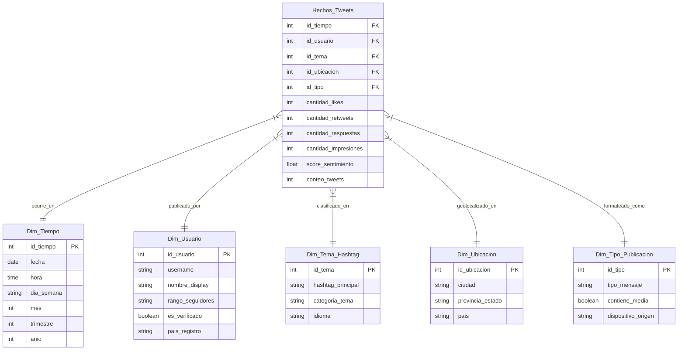

# GUÍA DE LECTURA IV: Bases de datos multidimensionales

## 1.  ¿Qué se entiende por db multidimensional? ¿Cómo se implementan?

Una base de datos multidimensional _(MDB)_ es un modelo de organización de datos concebido para el análisis interactivo de grandes volúmenes de información histórica (sistemas OLAP). Estructura la información en forma de **cubos de datos**.
Organiza la información en torno a dos componentes clave: **Hechos/Medidas** (valores numéricos cuantitativos a analizar) y **Dimensiones** (atributos cualitativos organizados jerarquicamente).

### Conceptos
- Cubo de datos: Estructura abstracta de _n_ dimensiones formada por un entramado de cuboides. El cuboide de menor nivel de agregación se denomina **base** y el de la cima **ápice**. Cada celda dentro del cubo representa una intersección específica y almacena una **medida agregada** (ej: monto_vendido = 450.000).
- Tabla de Hechos: Representan el tema central del negocio que se desea analizar (ej: Ventas, Envíos, Precipitaciones). Almacenan **medidas cuantitativas** y las claves foráneas (o subrogadas[^1]) que conectan con cada una de las tablas de dimensiones.
- Tabla de Dimensiones: Almacenan el contexto **cualitativo** o los atributos descriptivos de las entidades (ej: dim. Producto: nombre, marca, categoría o dim. Ubicación: ciudad, país, provincia). Organizan sus atributos en **jerarquías conceptuales** que permiten la navegación interactiva a distintos niveles de abstracción.

### Cómo se implementan
Se implementan mediante tres arquitecturas de servidores OLAP principales:

#### ROLAP (Relational)
Utiliza un sistema gestor de bases de datos relacionales para almacenar y gestionar los datos del almacén.
Modela los cubos multidimensionales mediante tablas relacionales de hechos y dimensiones estructuradas en los esquemas vistos. Emplea tablas de hechos de resumen e índices especializados para acelerar las consultas.
**Ventajas**: Soporta grandes volúmenes de datos transaccionales. Los cambios en el modelo de negocio se trasladan directo al SGDB, menor tiempo de carga inicial al no precargar multicubos pesados.[^2]
**Desventajas**: Tiempos de respuesta levemente mayores frente a MOLAP ya que requiere ejecutar JOINs y agregaciones SQL en tiempo de consulta).

#### MOLAP (Multidimensional)
Utiliza servidores propietarios con motores de almacenamiento basados en **arreglos/matrices multidimensionales**.
Mapea directamente las vistas del cubo sobre arreglos numéricos. Accede a los datos mediante direccionamiento directo por índice de posición en la matriz y aplica técnicas de compresión para manejar matrices dispersas (_sparse arrays_).
**Ventajas**: Muy rápido gracias a que las agregaciones se calculan y materializan previamente en la estructura de arreglos.
**Desventajas**: Dificultades de almacenamiento y rendimiento cuando el número de dimensiones se muy alto (más de 10 a 15 dimensiones). Ventanas de procesamiento y carga de datos prolongadas.

#### HOLAP (Hybrid)
Combina las escalabilidad de ROLAP con la velocidad de respuesta de MOLAP.
Almacena los grandes volúmenes de datos detallados a nivel transaccional en una BD relacional, mientras que las agregaciones y resúmenes de acceso frecuentemente se mantienen en un almacén multidimensional separado por arreglos (MOLAP).

## 2.  ¿Qué características tienen las tablas de hechos? ¿y las de dimensiones?

### Tablas de Hechos
Son las tablas centrales del modelo multidimensional que representan el tema o proceso de negocio que se desea analizar. Sus características son:

- Contienen medidas numéricas: Almacenan métricas cuantitativas acumulables y agregables que expresan las relaciones numéricas entre las dimensiones (ej: monto_vendido, unidades_vendidas, coso_envío).
- Almacenan claves foráneas: Contienen las claves de cada una de las tablas de dimensiones con las que se relacionan. La combinación de estas claves foráneas conforma la clave primaria compuesta de la tabla de hechos.
- Gran volumen de datos y crecimiento rápido: Es la tabla que concentra la mayor cantidad de registros del sistema, acumulando las observaciones a medida que transcurren las operaciones.
- Uso de claves subrogadas: Es altamente recomendable utilizar claves numéricas secuenciales generadas artificialmente sin significado de negocio, ya que reducen drásticamente el tiempo de lectura, espacio de almacenamiento e indexación en consultas masivas _(Por qué?)_

### Tablas de dimensiones
Son tablas que rodean a la tabla de hechos y representan las perspectivas o entidades bajo las cuales se analiza el problema de negocio (ej: Tiempo, Producto, Cliente, Ubicación). Sus características:

- Atributos cualitativos y descriptivos: Contienen texto y categorías descriptivas que otorgan contexto a las medidas de la tabla de hechos (ej: nombre_producto, marca, categoría, ciudad, provincia).
- Definen jerarquías conceptuales: Sus atributos están estructurados en niveles de abstracción jerárquicos. Estas jerarquías permiten ejecutar operaciones analíticas de agregación (_roll-up_) y desagregación (_drill-down_).
- Estructura desnormalizada y menor volumen de filas: Representan un porcentaje menor del volumen total del almacén. En esquemas en estrella se mantienen **desnormalizadas** (aceptando cierta redundancia de atributos) para evitar la realización de uniones (_JOINs_) complejas y acelerar el rendimiento de las consultas.
- Clave primaria única: Cada tabla de dimensión posee una clave primaria (idealmente subrogada de tipo entero) que la identifica unívocamente y se vincula con la tabla de hechos.

## 3.  ¿De qué depende la medida definida en una tabla de hechos?

En una tabla de hechos la **medida** S la propiedad numérica cuantitativa que representa el aspecto evaluable de un proceso de negocio. El valor, la interpretación y el comportamiento de una medida dependen de cuatro factores:

- La granularidad: Factor principal. Define el nivel de detalle atómico que representa cada fila en la tabla de hechos. El valor numérico de la medida depende directamente de los niveles jerárquicos elegidos para las dimensiones. Por ej: No es lo mismo la medida _monto\_ventas_ a nivel de "transacción individual por minuto" que a nivel "resumen mensual por categoría de producto y país". A mayor nivel de abstracción (mayor agregación), la medida sintetiza un volumen más amplio de datos.
- El Contexto Multidimencional: Una medida no existe de forma aislada. Su valor numérico se evalúa en un punto específico del espacio del cubo de datos. Cada valor de medida estrá determinado unívocamente por la combinación de claves foráneas de las dimensiones a las que está vinculada la tabla de hechos (ej: _<Tiempo, Producto, Ubicación, Sucursal>_). Son las dimensiones las que otorgan el contexto explicativo de la medida.
- La función de agregación y su tipo de aditividad: una medida se compone de dos elementos **la propiedad numérica y la fórmula/función de agregación** que permite combinar múltiples valores. El comportamiento de la medida depende de cómo responde a las agregaciones del cubo:
    * Aditivas: Se pueden sumar o consolidar de forma válida a lo largo de todas las dimensiones (ej: _unidades\_vendidas_, _monto\_total_).
    * Semi-aditivas: Se pueden sumar a lo largo de algunas dimensiones, pero no todas (ej: _saldo\_de\_cuenta_ o el _nivel\_de\_inventario_ se pueden sumar entre sucursales, pero no a lo largo del tiempo, ya que sumar saldos diarios genera un conteo duplicado/inválido).
    * No aditivas: No se pueden agregar directamente sumando sus componentes a lo largo de ninguna dimensión (ej: _precio\_promedio_, _porcentaje\_ganancia_, _mediana_), sino que requieren recalcularse sobre los datos de base.
- La naturaleza del fenómeno: El valor registrado en la medida depende también de cómo la organización captura el hecho. Los **eventos transaccionales** registran una acción puntual ocurrida en un instante de tiempo (ej. venta). Las **instantáneas** registran el estado de una entidad en un momento dado (ej. nivel de stock). Las **instantáneas acumuladas** registran la actividad acumulada hasta determinado punto (ej. ventas acumuladas en lo que va de año).

## 4.  Describa los diferentes esquemas de DW.

### Esquema de Estrella
**Más común y utilizada**
Posee una gran tabla de hechos que contiene las medidas cuantitativas del negocio sin redundancia y las claves hacia cada dimensión. A su alrededor se ubican radialmente las tablas de dimensiones.
Cada dimensión está representada por **una sola tabla no normalizada**.
**Ventaja**: al no normalizar las dimensiones, simplifica la estructura de las consultas SQL y reduce la cantidad de uniones (_JOINs_) necesarias, optimizando el rendimiento de la navegación OLAP.
**Desventaja**: Al estar desnormalizado, introduce cierta redundancia en los atributos descriptivos de las dimensiones (ej. repitiendo el estado o país en las filas de las distintas ciudades).

### Esquema en Copo de Nieve
Es una variante del esquema en estrella en la cual algunas tablas de dimensiones se encuentran normalizadas.
Al normalizar, las tablas de dimensiones se dividen en sub-tablas adicionales para reflejar explícitamente las jerarquías de conceptos, dándole al diagrama una forma similar a un copo de nieve.
**Ventaja**: Reduce la redundancia de datos dentro de las dimensiones, facilita su mantenimiento y ahorra espacio de almacenamiento.
**Desventaja**: El ahorro de espacio suele ser menor en comparación con el volumen total de la tabla de hechos. Además, reduce significativamente el rendimiento y la efectividad de la navegación, ya que requiere ejecutar un número elevado de _JOINs_ para resolver cada consulta.

### Esquema de Constelación o Galaxia
Consiste en un modelo sofisticado compuesto por múltiples tablas de hechos que comparten tablas de dimensiones entres sí.
Se visualiza como una colección o red de esquemas en estrella interconectados.
Es el esquema estándar en un **DW Empresarial**, ya que permite abarcar e integrar múltiples temas y procesos de negocio en toda la organización (por ej. relacionando las tablas de hechos Ventas y Envíos con dimensiones compartidas de Tiempo, Producto y Ubicación).
En contraste, para los **Data Marts**, se utilizan habitualmente los esquemas en _Estrella_ o _Copo de nieve_.

## 5.  ¿Cómo puede describir la relación entre las tablas de dimensiones y el esquema copo de nieve?

En un esquema de copo de nieve la relación con las tablas de dimensiones está definida por el principio de normalización. A diferencia del esquema de estrella (donde cada dimensión se representa en una única tabla desnormalizada), en el copo de nieve las tablas de dimensiones se dividen y descomponen en múltiples sub-tablas jerárquicas vinculadas entre sí.

Cada dimension que contiene atributos jerárquicos se divide en varias tablas de dimensiones secundarias interconectadas mediante claves foráneas. Por ej: la dimensión original _Ubicación_ se normaliza dividiéndose en la tabla _Ubicación_ conectada a una sub-tabla _Ciudad_ y esta a su vez puede conectarse con _Provincia_ y _País_.

Cada sub-tabla de dimensión en el copo de nieve pasa a representar a un nivel de abstracción específico dentro de la jerarquía de conceptos del modelo multidimensional (como Proveedor, Categoría o Ciudad).

La normalización de las dimensiones evita repetir atributos descriptivos de nivel superior (como repetir el nombre del país en cada registro de ciudad). Simplificando el mantenimiento de las dimensiones y reduciendo el espacio de las tablas.

Al estar la información de una misma dimensión distribuida en varia tablas, para resolver una consulta analítica es necesario realizar múltiples _JOINs_ en cadena entre la tabla de hechos y las sub-tablas de dimensión. Reduciendo el rendimiento y la velocidad de navegación.

## 6.  ¿Cuáles son los PROS y CONTRAS de un esquema copo de nieve en relación con un esquema de estrella?

### Pros
- Reducción de la redundancia de datos. Al normalizar se elimina la repetición innecesaria de atributos descriptivos de nivel superior.
- Mayor facilidad de mantenimiento y consistencia. Si cambia la descripción de una categoría, marca o región, la modificación se realiza en un único registro de la subtabla correspondiente, garantizando la integridad referencial sin necesidad de actualizaciones masivas.
- Ahorro de espacio de almacenamiento en las dimensiones. Al no duplicar datos las tablas de dimensiones ocupan menos espacio físco. _(pero esto es irrelevante frente a lo que ocupa la tabla de hechos ¿No?)_

### Contras
- Degradación de rendimiento por exceso de JOINs. Cualquier consulta analítica requiere utilizar múltiples uniones en cadena entre la tabla de hechos y las subtablas de dimensión, realentizando la ejecución de las consultas SQL.
- Mayor complejidad estructural y menor efectividad de navegación. La estructura visual y lógica resulta más compleja, lo que dificulta la exploración interactiva por parte de los usuario (sobre todo los No-técnicos) y complica el diseño de consultas.
- Ahorro de espacio insignificante en la práctica. Las dimensiones representan un muy pequeño porcentaje del volumen total de datos. No compensa la pérdida de rendimiento por el alamcenamiento extra.

## 7. Dibuje un ejemplo de esquema de estrella pensando en un problema de gestión de datos obtenidos desde Twitter. ¿Qué dimensiones considera necesarias? ¿Cómo quedaría la tabla de hechos? ***Comparta los resultados en el Slack***.

El objetivo es diseñar un Data Warehouse para analizar la difusión, repercusión, sentimiento y nivel de _engagement_ de publicaciones de **Twitter (X)** para campañas de marketing y análisis de opinión pública.

### Dimensiones necesarias
En un **esquema en estrella**, cada dimensión representa un aspecto cualitativo o contexto bajo el cual se analizan las métricas:

1. **Dim\_Tiempo**: Permite analizar tendencias temporales (*roll-up* de hora a día, mes o año).
  * `id_tiempo` (PK)
  * `fecha`, `hora`, `dia_semana`, `mes`, `trimestre`, `anio`
2. **Dim\_Usuario**: Atributos del autor de la publicación.
  * `id_usuario` (PK)
  * `username`, `nombre_display`, `rango_seguidores`, `es_verificado`, `pais_registro`
3. **Dim\_Tema\_Hashtag**: Clasificación temática del tweet.
  * `id_tema` (PK)
  * `hashtag_principal`, `categoria_tema` (ej. *Deportes, Política, Tech*), `idioma`
4. **Dim\_Ubicacion**: Origen geográfico del tweet (geolocalización).
  * `id_ubicacion` (PK)
  * `ciudad`, `provincia_estado`, `pais`
5. **Dim\_Tipo\_Publicacion**: Formato y características del mensaje.
  * `id_tipo` (PK)
  * `tipo_mensaje` (*Tweet original, Retweet, Reply, Quote*), `contiene_media` (*Sí/No*), `dispositivo_origen` (*Web, iOS, Android*)

### Estructura de la Tabla de Hechos
La **tabla de hechos central** almacena las claves foráneas hacia cada dimensión y las **medidas numéricas cuantitativas** agregables del proceso:

* **Claves Foráneas (FK)**:
  * `id_tiempo` (FK)
  * `id_usuario` (FK)
  * `id_tema` (FK)
  * `id_ubicacion` (FK)
  * `id_tipo` (FK)
* **Medidas Cuantitativas (Facts)**:
  * `cantidad_likes` (Aditiva)
  * `cantidad_retweets` (Aditiva)
  * `cantidad_respuestas` (Aditiva)
  * `cantidad_impresiones` (Aditiva)
  * `score_sentimiento` (Poladitival / Algebraica: valor numérico de -1.0 a +1.0)
  * `conteo_tweets` (Medida base = 1 para sumatorias)

### Diagrama en Estrella

## 8. ¿Qué función cumplen las jerarquías en una base de datos multidimensional? ¿Cuál es su relación con la tabla de dimensiones?

En el modelo multidimensional, las jerarquías cumplen las siguientes funciones fundamentales:

- Manejo de datos en diferentes niveles de abstracción: Permite organizar los conceptos desde valores de bajo nivel o datos detallados (_raw data_) hasta conceptos de alto nivel o más generales.
- Definición de relaciones de muchos a uno (N:1): Establecen secuencia de mapeos ordenados donde múltiples miembros o instancias de un nivel inferior se agrupan en una única categoría del nivel superior (ej: varias ciudades pertenecen a una misma provincia).
- Soporte para operaciones analíticas OLAP: Constituyen el motor conceptual para la navegación interactiva sobre los cubos de datos:
    * Roll-up: Permite ascender por la jerarquía para obtener datos resumidos y agregados (generalización).
    * Drill-down: Permite descender por la jerarquía para pasar de un alto nivel de resumen a un nivel más detallado o específico (desagregación).

La relación entre las jerarquías y las tablas de dimensiones se evidencia en varios aspectos de diseño y estructuración:

1. Correspondencia Atributo-Nivel: Cada nivel jerárquico de abstracción se corresponde directamente con un atributo específico dentro de la tabla de dimensión (Por ej: en la dimensión _Ubicación_, los atributos _calle_, _ciudad_, _provincia_, y _país_ representan los niveles jerárquicos)
2. Estructura Interna de la Dimensión: 
    * Orden Total: Los atributos forman una secuencia lineal simple donde cada nivel tiene un único camino de ascenso (ej. _calle_ < _ciudad_ < _provincia_ < _país_).
    * Orden Parcial: Los atributos se organizan en múltiples caminos de agregación alternativos dentro de la misma dimensión. Por ej en la dimensión _Tiempo_: _día_ < _mes_ < _año_ y simultáneamente _día_ < _semana_ < _año_.
3. Mapeo físico según el Esquema de DW:
    * Estrella: Toda jerarquía de la dimensión se almacena desnormalizada dentro de una única tabla de dimensión.
    * Copo de Nieve: La jerarquía se normaliza físicamente dividiendo la dimensión en múltipels sub-tablas vinculadas, donde cada sub-tabla representa un nivel de jerarquía.

## 9.  ¿Cuales son las operaciones OLAP?

### Roll-up
Realiza una agregación o generalización de los datos.
Se logra ascendiendo en la jerarquía de conceptos de una dimensión (por ej. pasar de ver ventas por ciudad a verlas por país) o eliminando una dimensión del cubo.
Muestra información más resumida de alto nivel.

### Drill-down
Es la operación inversa al roll-up, realiza una desagregación o especialización de los datos.
Se logra descendiendo en la jerarquía de conceptos (por ej. pasar re ver ingresos por trimestre a verlos por mes) o agregando una nueva dimensión al cubo.
Navega desde datos resumidos hacia datos de mayor detalle.

### Slice
Realiza una selección fijando un valor específico sobre una sola dimensión.
Extrae una "rebanada" o subcubo filtrado por esa condición (por ej. seleccionar únicamente los registros donde _Tiempo = 'Q1'_).

### Dice
Define un subcubo realizando una selección sobre dos o más dimensiones simultáneamente para valores específicos.
Funciona como un "zoom" que recorta el cubo sobre un subconjunto de criterios combinados (por ej. _Ubicación = ('Toronto' o 'Vancouver') y Tiempo = ('Q1' o 'Q2') y Producto = ('Laptop' o 'Teléfonos')_)

### Pivot
Es una operación de visualización que rota o gira los ejes del cubo.
Reorienta la presentación gráfica o tabular del los datos (por ej. intercambiando filas por columnas en una vista 2D) para ofrecer una perspectiva alternativa de análisis.

## 10. Escriba al menos 3 consultas utilizando las operaciones OLAP sobre el esquema de ejemplo del punto 7). ***Comparta los resultados en el Slack*.**

### Consulta 1: Roll-up
Objetivo: Obtener una visión global del alcance corporativo comparando las impresiones y retweets agregados por **país** y **año**, escalando en la jerarquía conceptual.
Consulta OLAP: Roll-up sobre la dimensión _Dim\_Ubicacion_ (ascendiendo de _ciudad_ a _pais_) y sobre _Dim\_Tiempo_ (ascendiendo de _fecha_ a _anio_)

SELECT u.pais,
    t.anio,
    SUM(h.cantidad\_impresiones) AS total\_impresiones,
    SUM(h.cantidad\_retweets) AS total\_retweets
FROM Hechos\_Tweets h
JOIN Dim\_Ubicacion u ON h.id\_ubicacion = u.id\_ubicacion
JOIN Dim\_Tiempo t ON h.id\_tiempo = t.id\_tiempo
GROUP BY u.pais, t.anio;

### Consulta 2: Slice
Objetivo: Filtrar la información para analizar el rendimiento y el sentimiento promedio de las publicaciones redactadas exclusivamente en idioma español (idioma = 'es').
Consulta OLAP: slice (fija una condición sobre una única dimensión del cubo).

SELECT th.hashtag\_principal,
    AVG(h.score\_sentimiento) AS promedio\_sentimiento,
    SUM(h.cantidad\_likes) AS total\_likes
FROM Hechos\_Tweets h
JOIN Dim\_Tema\_Hashtag th ON h.id\_tema = th.id\_tema
WHERE th.idioma = 'es' GROUP BY th.hashtag\_principal;

### Consulta 3: Dice
Objetivo: Investigar el nivel de interacción de usuarios verificados ubicados en Argentina durante el cuarto trimestre de 2026.
Consulta OLAP: dice (aplica condiciones de selección sobre dos o más dimensiones simultáneamente).

SELECT u.username,
    t.mes,
    tp.tipo\_mensaje,
    SUM(h.cantidad\_likes) AS total\_likes,
    SUM(h.cantidad\_respuestas) AS total\_respuestas
FROM Hechos\_Tweets h
JOIN Dim\_Usuario u ON h.id\_usuario = u.id\_usuario
JOIN Dim\_Ubicacion ub ON h.id\_ubicacion = ub.id\_ubicacion
JOIN Dim\_Tiempo t ON h.id\_tiempo = t.id\_tiempo
JOIN Dim\_Tipo\_Publicacion tp ON h.id\_tipo = tp.id\_tipo
WHERE u.es\_verificado = TRUE
    AND ub.pais = 'Argentina'
    AND t.trimestre = 4
    AND t.anio = 2026
GROUP BY u.username, t.mes, tp.tipo\_mensaje;

## 11. Identificar los PROS/CONTRAS de las tecnologías ROLAP, MOLAP y HOLAP.

### ROLAP
#### Ventajas
- Capaz de manejar volúmenes de datos masivos (Terabytes o Petabytes) y modelos con gran cantidad de dimensiones o millones de miembros.
- Permite ejecutar _drill-through_ hacia los registros atómicos almacenados en las tablas relacionales de base.
- Los cambios en el modelo dimensional se trasladan inmediatamente a la base de datos relacional y quedan disponibles para consulta de forma instantánea.
- La carga inicial e incremental es más rápida porque no requiere el tiempo prolongado de generación previa de multicubos físicos en disco.
- Interactúa directamente vía SQL contra motores relacionales maduros.

#### Contras
- Las consultas suelen tardar entre segundos y minutos, ya que deben resolver múltiples uniones y agregaciones SQL en tiempo de ejecución.
- Para lograr un buen rendimiento requiere aplicar continuamente técnicas de _tuning_, vistas materializadas, indexición _bitmap_ y memoria caché.

### MOLAP
#### Ventajas
- Ofrece respuesta en pocos segundos gracias a que las agregaciones se calculan previamente y se accede directamente por posición en la matriz.
- Aplica técnicas de compresión de matrices dispersas.
- La estructura matricial/vectorial ofrece un direccionamiento intrínseco por coordenadas.
- Automatiza el procesamiento de datos agregados a niveles superiores.

#### Contras
- Presenta serias limitaciones cuando el modelo supera las 10 a 15 dimensiones o maneja cardinalidades de millones de miembros.
- La fase de precálculo y generación de cubos físicos puede ser sumamente prolongada con grandes volúmenes de datos.
- El cubo suele tratarse como una estructura encriptada y propietaria, cualquier cambio en el modelo puede exigir recalcular todos los cubos desde cero.
- Introduce redundancia al almacenar físicamente múltiples niveles de agregaciones previamente calculadas

### HOLAP
#### Ventajas
- Logra alta escalabilidad de ROLAP para almacenar el histórico detallado junto con la velocidad de respuesta inmediata de MOLAP para las consultas agregadas habituales.
- Evita sobrecargar la matriz multidimensional con millones de registros atómicos sin sacrificar la velocidad en las vistas de alto nivel.

#### Contras
- Exige administrar, configurar y mantener sincronizados dos sistemas gestores distintos.
- Requiere coordinar estrictamente los ciclos de refresco para evitar discrepancias entre los datos del nivel de retalle (ROLAP) y las agregaciones del cubo (MOLAP).

---

> [Bibliografía sugerida]:

- Data Mining. Concepts and Techniques. Jiawei Han and Micheline Kamber.
  Capítulo 3.

[^1]: asegurarme de comprender bien el concepto de clave subrogada.
[^2]: revisar bien cómo es el tema del menor tiempo de carga inicial en ROLAP ¿Es cierto?
